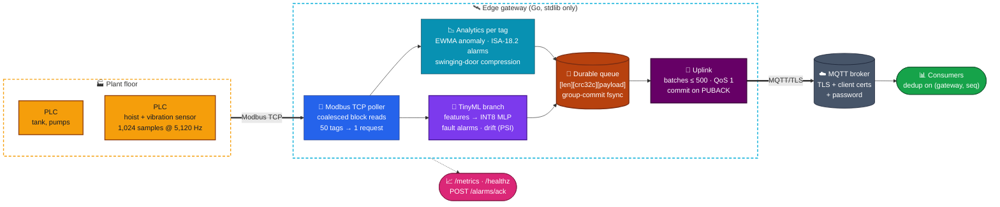
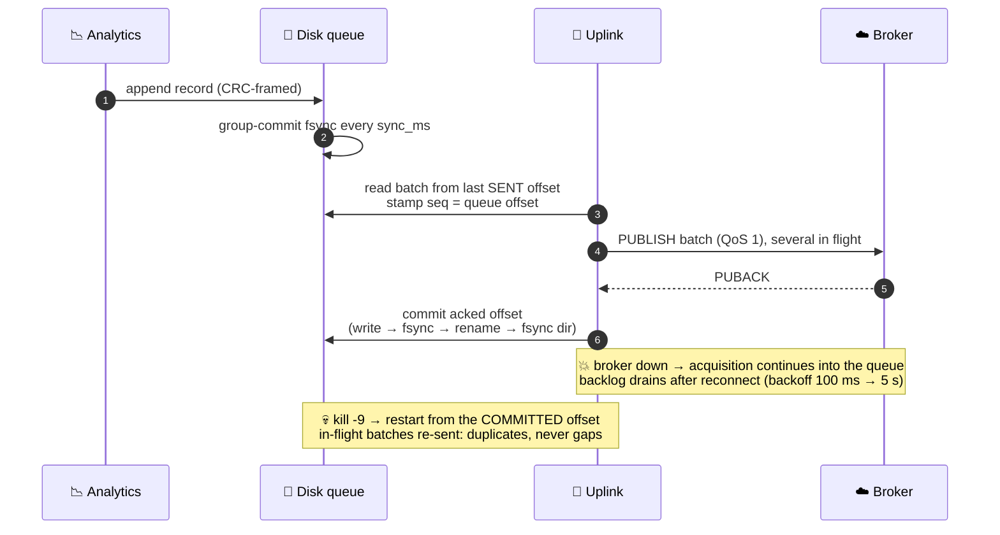
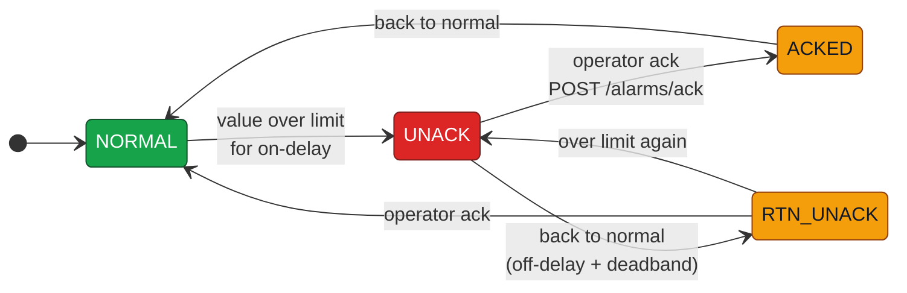
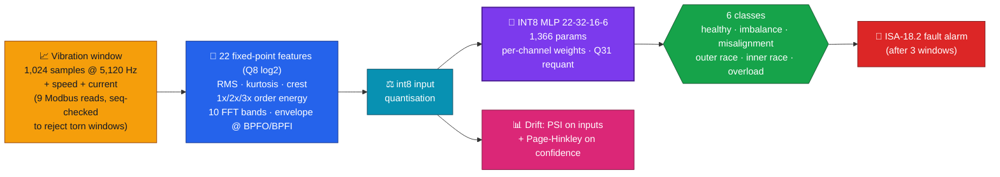
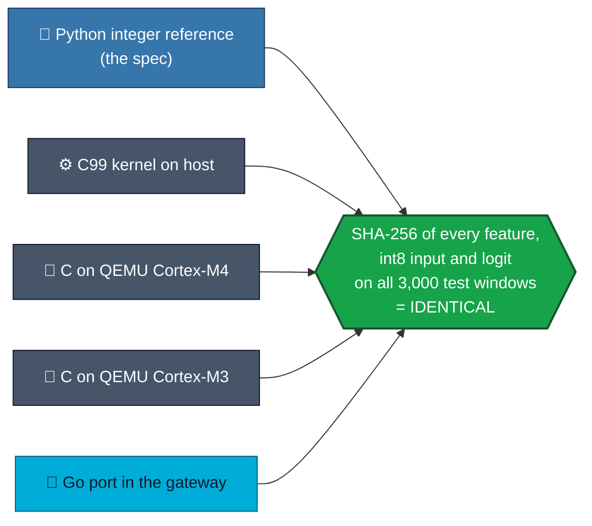
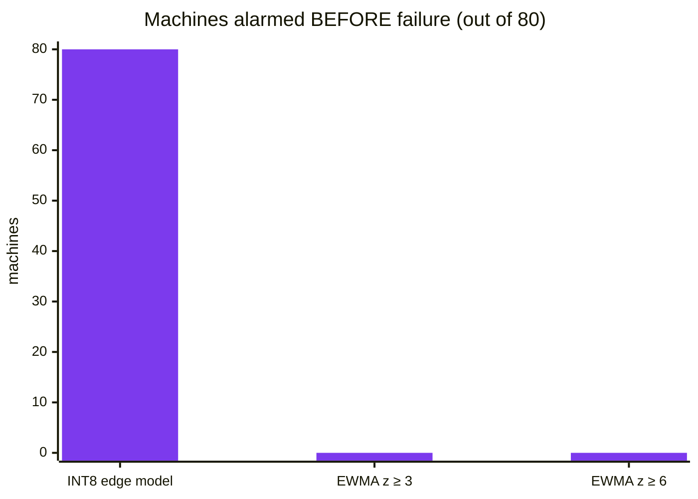

<div align="center">

# 🏭 Industrial Edge Gateway

### An industrial IoT edge gateway in pure Go: it polls PLCs over Modbus, compresses and analyses data at the edge, runs an INT8 fault-detection model, and delivers to the cloud over MQTT/TLS without losing a record across crashes and outages

**Modbus TCP and MQTT 3.1.1 implemented from the specs · crash-safe disk queue · ISA-18.2 alarms · TinyML on Cortex-M, bit-exact across Python, C and Go**

<br/>


[**Architecture**](#%EF%B8%8F-architecture) · [**Delivery guarantee**](#-delivery-guarantee-nothing-lost) · [**Edge analytics**](#-edge-analytics) · [**TinyML**](#-tinyml-fault-classifier) · [**Predictive maintenance**](#-predictive-maintenance) · [**Security**](#-security) · [**Testing**](#-testing) · [**Run it**](#-run-it)

</div>

---

## 📌 TL;DR

Factory machines speak **Modbus**; clouds speak **MQTT**. Between them sits an edge gateway that must keep working when the network drops, the process gets killed, or the power fails. This one is built from first principles:

| | |
|---|---|
| 🔌 **Protocols from the specs** | Modbus TCP client/server and MQTT 3.1.1 (QoS 1) written from scratch; **Go standard library only** |
| 📉 **Edge analytics** | **Swinging-door compression with a proven error bound** · EWMA anomaly detection · **ISA-18.2** alarm state machine |
| 💾 **Durability** | CRC-framed segmented disk queue, group-commit fsync; data is committed only on the broker's **PUBACK** |
| 🧠 **Edge ML** | INT8 MLP fault classifier on vibration windows (FFT + order-tracking features) with **PSI / Page-Hinkley drift detection** |
| 🔬 **Microcontroller-ready** | Dependency-free C99 kernel for **ARM Cortex-M**: about 11 KB flash and 10.5 KB RAM, **bit-exact** with the Python reference and the Go port, tested in QEMU |
| 🔐 **Secure uplink** | TLS 1.2+, client certificates and passwords; the gateway **refuses to start** with insecure configs |

---

## 🏗️ Architecture



---

## 🔒 Delivery guarantee: nothing lost



| Failure | Behaviour | Verified by |
|---|---|---|
| ☁️ Broker down | Acquisition continues into the queue; backlog drains after reconnect | e2e test |
| 💀 Gateway `kill -9` | Restart from the committed offset: **every seq delivered, no gaps** (3–9 duplicates from in-flight batches) | e2e test, repeated 4× |
| ⚡ Power loss | At most `sync_ms` of samples lost; the torn tail is truncated on start | queue **crash-at-every-byte** test |
| 🔌 PLC down | Tags marked `quality: bad`, `/healthz` fails, recovers automatically | e2e test |
| 💽 Disk full | Oldest segments dropped and **counted**; acquisition never stops | queue test (dropped + backlog = appended) |

> **Caught by CI:** if shutdown began while the uplink was *between* connections, it exited without draining. The e2e test now stops the gateway **while the broker is down**; it fails on the old code (53–55 records left queued) and passes with the fix.

---

## 📉 Edge analytics

### ISA-18.2 alarm state machine



<sub>On/off delays and a deadband suppress chattering alarms. The same machine raises fault alarms from the ML model.</sub>

### Swinging-door compression, with a *proven* error bound

The textbook algorithm archives the *previous raw sample* when the "doors" close, and a property test showed **that can break the error bound** (seed 0, dev 0.05 → error 0.059). This implementation instead tracks the **interval of feasible slopes** that keep the line within ±dev of *every* sample since the last archived point, and archives on the middle slope when that interval empties. The reconstruction then **provably** stays within ±dev, which a property test checks over 200 random signals at 3 deviations.

**Result:** **38–105× compression** on ramping signals at ±0.2–0.5, with the bound held exactly.

---

## 🧠 TinyML fault classifier



### One model, four implementations, identical bits



| Metric | Value |
|---|---|
| **Accuracy** (3,000 windows, **held-out 1000–1300 rpm speed band**) | **INT8 96.73%** (macro F1 0.968) vs float 96.70%; the two agree on 99.77% of windows |
| **Cortex-M4 footprint** (`arm-none-eabi-gcc -O2`) | **3.0 KB code + 8.1 KB constants** (6 KB are FFT tables) · **10.2 KB RAM** · < 300 B stack |
| **Work per window** (QEMU, instruction count) | about 490k instructions; **FFTs ≈ 98%**, the MLP only about 2% · estimated 6–9 ms at 80 MHz (not measured on a board) |
| **Gateway (Go port)** | about 47 µs per window |
| **Drift** | PSI alerts on a 70% sensor-gain loss and on unseen speeds; **none** on 1,500 in-distribution windows. The model stays *confident* on drifted inputs, which is why input PSI is needed |

> [!IMPORTANT]
> Trained and tested on **synthetic data** from a physics-inspired crane-hoist simulator (bearing defect frequencies, resonances, gear mesh, sensor-gain variation, knocks). It has never seen a real machine. Cortex-M figures come from QEMU, which isn't cycle-accurate. A personal project, separate from any internship work. Details: [`tinyml.md`](docs/tinyml.md)

---

## 🔧 Predictive maintenance

Run-to-failure simulation: **80 machines degrading over days**, the same alarm rule for every detector (raise after 3 positive windows).



| Detector | Precision | Recall | F1 | False alarms / machine-day | Median lead time |
|---|:---:|:---:|:---:|:---:|:---:|
| **INT8 edge model** | **0.919** | **0.926** | **0.923** | 0.109 | **11.2 days** |
| EWMA z ≥ 3 (classic spike detector) | 0.434 | 0.004 | 0.008 | 0 | — |

<sub>Why EWMA fails: its time constant (about 3 h) absorbs a fault that grows over days into the moving average. It's a spike detector, the wrong tool for wear. <b>Honest caveat:</b> about one false alarm per machine every 9 days is too high for production, and lead times are somewhat optimistic. See <a href="docs/predictive-maintenance.md"><code>predictive-maintenance.md</code></a>.</sub>

---

## 📊 Performance

| Benchmark | Result |
|---|---|
| **1,000 tags at 10 Hz** (20 simulated PLCs) → MQTT | **10,000 records/s** sustained · end-to-end p50 **42 ms**, p99 **127 ms** · 0.59 cores *including* the simulated plant |
| **Durable queue** | **733k appends/s** with 100 ms group commit (5.3k/s with fsync per record) · 1M-record recovery scan in **63 ms** |
| **Read coalescing** | 50 tags → **1** Modbus request per poll (≤ 8-register gaps bridged, ≤ 125 registers per read) |

Details: [`benchmarks.md`](docs/benchmarks.md)

---

## 🔐 Security

- **MQTT over TLS 1.2+** with server verification, **client certificates** and **passwords**.
- **Refuses to start** if `require_tls` is set without TLS, if a password would travel in plaintext, or if TLS has no CA (no unverified TLS).
- **Tested against a real mosquitto** with a TLS-only listener and `require_certificate`: a valid client works, while a wrong password, no credentials, no client cert, an untrusted client CA, an untrusted server CA and plaintext are **all refused**.
- **Docker:** multi-stage build, static binaries, non-root, health check; compose runs a TLS-only broker plus the simulator plus the gateway. **`deploy/smoke.sh` passed**: in 20 s it received samples, predictions and a `bearing_outer` fault alarm, and both insecure clients were refused.

Details: [`security-deployment.md`](docs/security-deployment.md)

---

## ✅ Testing

| Package | Highlights |
|---|---|
| `modbus` | 2,000 random frame round trips · malformed MBAP rejected **before allocating** · every function code · re-dial on dropped connections |
| `mqtt` | 500 QoS 1 messages through real mosquitto · broker-death detection · remaining-length encoding at every boundary · TLS refusal matrix |
| `queue` | **Crash at every byte offset** recovers exactly the complete records · zero-filled tail · corruption in older segments detected · disk-cap accounting exact |
| `analytics` | **Swinging-door error-bound property** (200 signals × 3 deviations) · EWMA ignores noise, catches a 15σ spike · alarm chatter suppression and acks |
| `tinyml` · `drift` | **Bit-exact on all 3,000 windows** · PSI quiet in-distribution, alerts on gain loss and unseen speeds · Page-Hinkley |
| `e2e` | Built binary + simulated PLC + mosquitto: **broker outage + `kill -9` + graceful stop during an outage → every seq delivered** · PLC outage recovery · TLS + inference end to end |

`go test -race ./internal/...` is clean. Details: [`testing.md`](docs/testing.md)

---

## 🚀 Run it

```bash
go build ./cmd/edgegw ./cmd/plcsim
./plcsim -listen 127.0.0.1:5020 -spike-every 500 &
mosquitto -p 1883 &
./edgegw -config configs/example.json            # metrics at http://127.0.0.1:9100/metrics
mosquitto_sub -t 'plant1/gw1/data' -q 1           # JSON batches
curl -X POST 'http://127.0.0.1:9100/alarms/ack?dev=tank1&tag=level'
```

<details>
<summary><b>🐳 Docker, TinyML pipeline, tests, benchmarks</b></summary>

<br/>

```bash
deploy/smoke.sh                 # TLS broker + hoist simulator + gateway, end to end in Docker
tinyml/run_all.sh               # train → quantise → C/QEMU bit-exactness checks
go test ./...                   # MQTT + e2e need mosquitto on PATH (or /usr/sbin/mosquitto)
go run ./cmd/edgebench -out bench/results/$(date +%F) -broker 127.0.0.1:1883
python3 bench/report.py <date>
```

</details>

---

## ⚠️ Limitations

- **All ML results use synthetic data and emulated hardware.** No real sensor data or real-board cycle counts yet ([`OWNER_ACTIONS.md`](docs/OWNER_ACTIONS.md) has the STM32 Nucleo DWT measurement script).
- **The model's false-alarm rate is too high for production.** Alarm and drift thresholds are untuned.
- **Modbus TCP only:** no RTU, OPC UA or EtherNet/IP.
- **At-least-once delivery:** consumers must de-duplicate on `(gateway_id, seq)`.
- **No fleet management, certificate rotation, CRL/OCSP or per-topic broker ACLs.** The demo PKI isn't production-grade.

Full list: [`limitations.md`](docs/limitations.md) · Architecture: [`architecture.md`](docs/architecture.md) · Requirements: [`requirements.md`](docs/requirements.md)

---

## 📁 Repository layout

```text
INDUSTRIAL_EDGE/
├── cmd/
│   ├── edgegw/      🛰️ the gateway
│   ├── plcsim/      🏭 Modbus PLC simulator (tank + hoist)
│   ├── vibgen/      📈 vibration data generator
│   ├── edgebench/   📊 benchmark harness
│   └── pdmeval/     🔧 run-to-failure evaluation
├── internal/
│   ├── modbus/      🔌 Modbus TCP client + server (from spec)
│   ├── mqtt/        📡 MQTT 3.1.1 client, QoS 1, TLS (from spec)
│   ├── queue/       💾 crash-safe segmented disk queue
│   ├── analytics/   📉 swinging door · EWMA · ISA-18.2 alarms
│   ├── tinyml/      🧠 Go INT8 inference port
│   ├── drift/       📊 PSI + Page-Hinkley
│   ├── hoistsim/    🏗️ physics-inspired vibration simulator
│   └── gateway/     🛰️ config, polling, inference, uplink, HTTP
├── tinyml/          🔬 training (Python), C99 kernel, Cortex-M QEMU + STM32 board builds
├── e2e/             ✅ end-to-end tests with real mosquitto
├── deploy/          🐳 certs, compose, smoke test
└── docs/            📖 architecture · tinyml · predictive maintenance · security · testing · benchmarks
```

---

<div align="center">

**From the PLC register to the cloud, with nothing lost on the way.**

<br/>

Built by **[Siddhant Singh](https://github.com/siddhaantxsingh)** · <sub>MIT License</sub>

</div>
